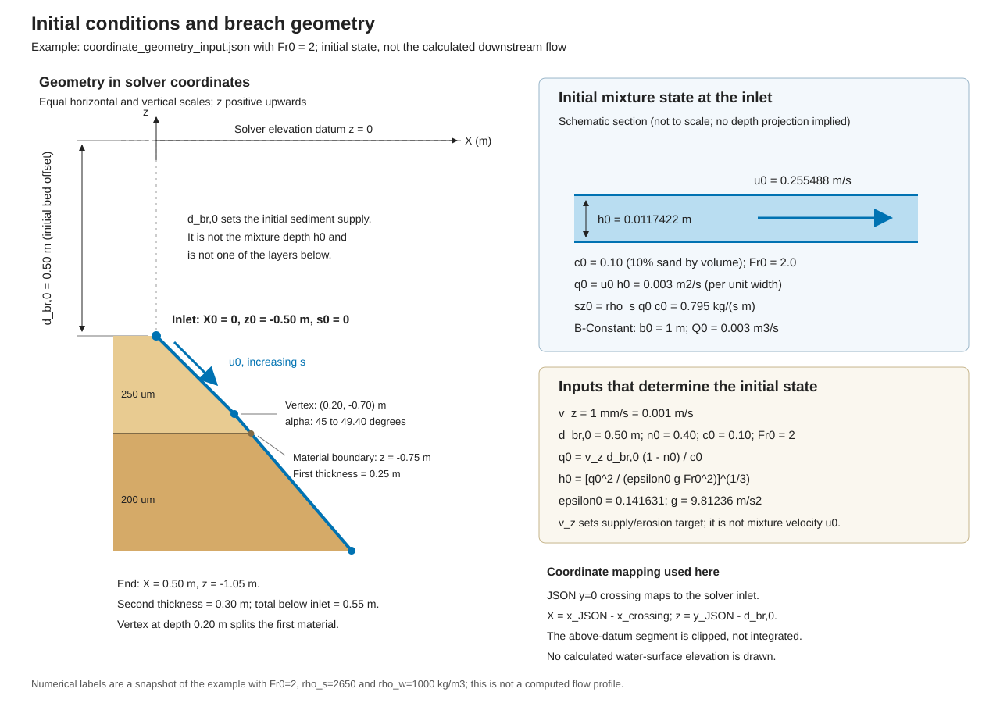
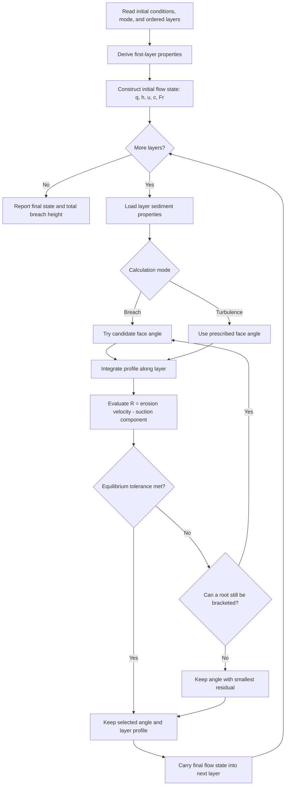

# HMBreach scientific model

HMBreach implements the multilayer HMBRES breach-flow calculation. For each
sediment layer, it integrates a steady mixture-flow profile along an inclined
breach face. In breach mode, the face angle is adjusted until the calculated
erosion velocity at the end of that layer is consistent with the imposed
suction velocity. Turbulence mode instead integrates at prescribed layer
angles.

This note describes the equations and numerical sequence implemented in
[`src/HMBres.cpp`](./src/HMBres.cpp) and
[`src/LayerSystem.cpp`](./src/LayerSystem.cpp).

## Coordinates and state

Let $s$ be distance along the breach face, increasing in the flow direction,
and $\alpha$ the face angle measured from the horizontal. The horizontal and
vertical coordinates therefore evolve as

$$
\frac{dx}{ds}=\cos\alpha,\qquad
\frac{dz}{ds}=-\sin\alpha.
$$

The velocity terms used throughout the documentation are:

- $v_{\mathrm{eros}}$: local erosion velocity used in the profile equations; in the code this is `erosion_velocity`.
- $v_{\mathrm{eros,end}}$: erosion velocity at the end of the layer; in the code this is `final_erosion_velocity`.
- $v_{\mathrm{sed}}$: hindered-settling/sedimentation velocity; in the code this is `sedimentation_velocity`.
- $v_{\mathrm{entr}}$: entrainment velocity; in the code this is `entrainment_velocity`.
- $v_z$: imposed suction velocity (vertical erosion rate target), used in the equilibrium condition.
- $v_{\mathrm{crit}}$: critical grain velocity used in the erosion formulation,
  $v_{\mathrm{crit}}=\sqrt{\delta g d_{50}}$.

The corresponding code objects are `result.final_erosion_velocity` and the
layer-level residual
`result.residual = final_erosion_velocity - vz * std::sin(alpha);`.

The flow state is described by mixture depth $h$, mixture velocity $u$,
and sand volume concentration $c$, together with width $b$. Specific
discharge per unit width is $q=uh$, while total discharge is $Q=qb=uhb$.
The original model uses a one-metre unit-width strip. The model's
concentration-dependent density factor and densimetric Froude number are

$$
q=uh,\qquad
Q=uhb,\qquad
\epsilon=\frac{\delta c}{1+\delta c},\qquad
\mathrm{Fr_densiometric}=\frac{u}{\sqrt{\epsilon g h}},\qquad
\mathrm{Fr_internal}=\frac{u^{2}}{\epsilon g h cos(\alpha)},
\qquad
\delta=\frac{\rho_s-\rho_w}{\rho_w}.
$$

Here $g$ is gravitational acceleration, and $\rho_s$ and $\rho_w$ are
sediment and water density. The initial state is derived from suction velocity
$v_z$, initial layer thickness $d_{br,0}$, initial concentration $c_0$,
and initial Froude number $\mathrm{Fr}_0$:

$$
q_0=\frac{v_z d_{br,0}(1-n_0)}{c_0},\qquad
h_0=\left(\frac{q_0^2}{\epsilon_0 g\mathrm{Fr}_0^2}\right)^{1/3},
\qquad u_0=\frac{q_0}{h_0}.
$$

For variable-width calculations, total initial discharge is
$Q_0=q_0b_0$, where $b_0$ is the user-supplied initial width.
The initial bed elevation is $z_0=-d_{br,0}$, with $x_0=0$. Porosity is
$n$; $n_0$ denotes the initial layer porosity.

### Initial conditions relative to the geometry



The figure uses
[`coordinate_geometry_input.json`](./examples/coordinate_geometry_input.json)
with $\mathrm{Fr}_0=2$. It distinguishes the initial bed offset
$d_{br,0}=0.50$ m from the much smaller mixture depth $h_0=0.0117422$ m.
The offset sets both the initial bed elevation and the sediment supply;
it is not added to the thickness of either material layer in the JSON.
With $v_z=0.001$ m/s, $n_0=0.40$, and $c_0=0.10$, the initial
specific discharge is $q_0=0.003$ $\mathrm{m^2/s}$ and the mixture
velocity is $u_0=0.255488$ m/s. The suction velocity $v_z$ is not $u_0$.

For coordinate-defined inputs, the reader clips the input polyline at its
JSON $y=0$ crossing and uses the descending segments to determine layer
angles. The solver starts at $(X_0,z_0)=(0,-d_{br,0})$ and follows those
segments below that starting elevation. Thus, in this prescribed-angle
example, the relationship to the original input coordinates is

$$
X=x_{\mathrm{JSON}}-x_{\mathrm{crossing}},\qquad
z=y_{\mathrm{JSON}}-d_{br,0}.
$$

The input endpoint $(0.50,-0.55)$ m therefore corresponds to the solver
endpoint $(0.50,-1.05)$ m. The two material thicknesses, $0.25$ and $0.30$ m,
are measured below the inlet. A slope vertex at input depth $0.20$ m splits
the first material into two computational segments without introducing a
new material. In breach mode the equilibrium search can change the angles,
so the final calculated geometry need not preserve this input-coordinate
mapping.

The inlet-section inset is schematic and does not define a vertical or
bed-normal projection for $h_0$. No water-surface elevation is drawn:
`initial_state` initializes its `water_level` using a fixed 75-degree angle;
subsequent integration uses the actual layer angle in
`water_level = z + h*sin(alpha)`. The drawing shows the bed geometry and
initial state variables, not a computed water surface. Numeric labels are
a documented snapshot of this example, not automatically regenerated values.

## Derived sediment and fluid properties

For each layer, the model derives the relative submerged density, kinematic
viscosity, dimensionless grain diameter, and characteristic velocity from the
physical constants and sediment inputs:

$$
\delta=\frac{\rho_s-\rho_w}{\rho_w},\qquad
\nu=\frac{40}{20+T}\,10^{-6},\qquad
d_*=d_{50}\left(\frac{\delta g}{\nu^2}\right)^{1/3},\qquad
v_{\mathrm{crit}}=\sqrt{\delta g d_{50}}.
$$

Here $T$ is water temperature in degrees Celsius (default $15^\circ$C),
$d_{50}$ is in metres, and $\nu$ is in $\mathrm{m^2/s}$. The settling
velocity is calculated using the implemented Van Rijn expression, except for
grains smaller than $0.1$ mm, for which the Stokes expression replaces it:

$$
w_0=\frac{10\nu}{d_{50}}
\left[
\sqrt{1+\frac{0.01\delta g d_{50}^3}{\nu^2}}-1
\right],
\qquad d_{50}\geq 10^{-4}\ \mathrm{m},
$$
$$
w_0=\frac{\delta g d_{50}^2}{18\nu},
\qquad d_{50}<10^{-4}\ \mathrm{m}.
$$

If a layer does not specify permeability, the model estimates it from
porosity and grain size. By default, $d_{15}=d_{50}/1.75$. A layer can instead
set `user_d15` to `true` and provide `d15_micrometre`; that user-specified
diameter is used in the permeability estimate:

$$
d_{15}=\frac{d_{50}}{1.75},\qquad
k=\frac{g}{160\nu}\,
\frac{n^3}{(1-n)^2}\,d_{15}^2.
$$

This gives permeability $k$ in $\mathrm{m/s}$. `user_d15` defaults to `false`;
when true, a positive `d15_micrometre` is required. A positive user-supplied
permeability is used instead of this estimate. In JSON, the optional
`permeability_mm_s` input is given in mm/s and converted to m/s. The
dilatancy/permeability parameter is then

$$
d_{nk}=\frac{1}{17k}
$$

by default. With the standard $\delta_n=0.04$, subsequent layers use loosened
porosity and permeability,

$$
n_1=\frac{n_0+\delta_n}{1+\delta_n},\qquad
k_1=k_0\,
\frac{n_1^3/(1-n_1)^2}{n_0^3/(1-n_0)^2},\qquad
d_{nk}=\frac{\delta_n}{k_1}.
$$

For the first layer, its base permeability $k_0$ (specified or calculated) is
used with $d_{nk}=\delta_n/k_0$.

### Vertical-wall retreat velocity

The legacy vertical-wall retreat diagnostic $v_{\mathrm{wal}}$ is evaluated
with a wall angle $\alpha_{\mathrm{wall}}=90^\circ$:

$$
v_{\mathrm{wal}}
=-\frac{i+(1-n)\delta\,
          \sin(\phi-\pi/2)/\sin\phi}{d_{nk}}
=\frac{(1-n)\delta\cot\phi-i}{d_{nk}},
$$

where $i$ is the layer's external hydraulic gradient and $\phi$ is the
friction angle. The result has units of m/s. Its sign is preserved without
clamping: a negative result indicates that this expression predicts no
positive wall retreat under the supplied gradient.

The C++ property `DerivedProperties::wall_retreat_velocity` uses the
layer's existing $d_{nk}$, including the first-layer distinction,
user-specified permeability/d15, and the optional fixed HMBRES dilatancy
approximation described above. This reproduces the legacy wall formula;
numeric agreement additionally requires matching permeability and dilatancy
inputs. In particular, legacy C# recalculates permeability from grain size
for subsequent layers, whereas C++ respects a positive user permeability.
The first computational layer uses base permeability; subsequent layers
use loosened permeability when $\delta_n$ is enabled, even when a geometry
vertex splits the same material into multiple computational layers.

For fixed layer properties and constants, $v_{\mathrm{wal}}$ is constant:
it does not depend on evolving $h$, $u$, $c$, or the actual face angle.
It is **not** the imposed $v_z$, the local inclined-face
$v_{\mathrm{eros}}$, or the critical grain velocity $v_{\mathrm{crit}}$.
It is stored in `LayerResult::wall_retreat_velocity`, printed per layer, and
exported as `v_wal` in workbook and CSV profile rows. The workbook plotter
accepts this as an optional column, preserving support for older workbooks.
It is a diagnostic only: no flow derivative, integration step, or
equilibrium condition uses it.

## Governing profile equations

The flow equations use the erosion velocity $v_{\mathrm{eros}}$, the entrainment velocity $v_{\mathrm{entr}}$, and the hindered-settling/sedimentation velocity $v_{\mathrm{sed}}$. In the code these correspond to the local solver variables `erosion_velocity`, `entrainment_velocity`, and `sedimentation_velocity` inside `integrate_layer(...)`; the output profile records keep the same names in `StepRecord`.

Define

$$
C_f=\frac{f_0+f_{ki}f_0}{8},\qquad
S_1=\frac{1-n-c}{c}\left(\frac12+\epsilon\mathrm{Fr}^2\right)
      +2\mathrm{Fr}^2,\qquad
S_2=\frac{h}{b}\left(\frac12+\epsilon\mathrm{Fr}^2\right),\qquad
S_3=\frac12+\epsilon\mathrm{Fr}^2-2\mathrm{Fr}^2.
$$

The profile equations for a width $b(s)$ are

$$
(1-\mathrm{Fr}^2)\frac{dh}{ds}
=-\frac{S_1v_{\mathrm{eros}}}{u}
+\frac{S_3v_{\mathrm{entr}}}{u}
+S_2\frac{db}{ds}
+\sin\alpha-C_f\mathrm{Fr}^2,
$$

$$
\frac{du}{ds}=
\frac{v_{\mathrm{eros}}+v_{\mathrm{entr}}-u\,dh/ds}{h}
-\frac{u}{b}\frac{db}{ds},\qquad
\frac{dc}{ds}=\frac{(1-n-c)v_{\mathrm{eros}}-cv_{\mathrm{entr}}}{q}.
$$

These are the momentum and continuity equations from the supplied model
description. The angle $\beta$ used there corresponds to $\alpha$ here. In the
code, $b$ is `state.width`, $db/ds$ is `db_ds`, and these terms are evaluated
in `integrate_layer(...)`. The solver integrates the equivalent horizontal-X
form below; the along-slope equations here remain the physical starting point.
Select the width model with
`settings.width_model`:

- `"b_constant"` (default, B-Constant) sets $b=1$ m and $db/ds=0$,
  reproducing the original one-dimensional per-unit-width calculation.
- `"b_fit"` (B-Fit) fits the supplied initial and per-layer-bottom widths as
  a function of bed elevation $z$. The input coordinates are normalized to
  $x=1-z/D$, where $D$ is the deepest sample's absolute elevation. `"poly4"`
  is the default fit; the other options are straight line, Poly2, Poly3, Exp,
  Power, Log, Rodbard, and Gamma variate. Exp and Power use
  $b=a e^{c x}$ and $b=a x^c$; Log uses $b=a+c\ln(x)$. Rodbard uses the
  four-parameter logistic form
  $b=a+(d-a)/(1+(x/c)^p)$, and Gamma variate uses
  $b=a+d(x-1)^p e^{-(x-1)/c}$ for $x>1$ and $b=a$ at $x=1$.
- `"b_calc"` (B-Calc) evolves width using the optional Fanning gravity-current
  relation

  $$
  \frac{db}{ds}=\frac{2\sqrt{2\epsilon g h}}{u}.
  $$

- `"geometry"` requires `initial_conditions.initial_width_m` and one or more
  `settings.width_geometry` points with `s_m` and `width_m`. Points are
  linearly interpolated from $(s,b)=(0,b_0)$; beyond the last point, the final
  width is held constant. `"unit_width"` and `"fanning"` are accepted as
  aliases for `"b_constant"` and `"b_calc"`.

For B-Fit, B-Calc, and geometry, $b_0$ must be finite and positive. The
computed total discharge and sediment transport are $Q=qb$ and
$S_{\mathrm{total}}=S_{\mathrm{per\ width}}b$; the existing `q` and
`sediment_transport` result columns remain per unit width. Profile output also
contains `width_m`, `total_discharge`, and `total_sediment_transport`.

In the default fixed-step mode, the denominator $1-\mathrm{Fr}^2$ is guarded
numerically near critical flow.
After each step, the model updates $q=uh$, concentration, $\epsilon$, and
the Froude number from the new state. Integration uses an explicit Euler step
in horizontal $X$, using $\Delta X=\Delta s\cos\alpha$. The along-slope step
$\Delta s$ is still selected as before and limited to end exactly at the layer
boundary and, for geometry width, at each specified width point.

### Optional adaptive spatial integration

Setting `adaptive_step_sizing` to `true` enables Euler step doubling without
changing the governing equations. For a state vector $y=(h,u,c,b)$, the solver
compares a full Euler step $y_{\mathrm{full}}$ of length $\Delta X$ with
$y_{\mathrm{half}}$, obtained from two successive steps of length
$\Delta X/2$. All state-dependent source terms and width evolution are
re-evaluated at the intermediate state. Define

$$
e_i = |y_{\mathrm{half},i}-y_{\mathrm{full},i}|,\qquad
E=\max_i\frac{e_i}{
  \mathrm{atol}+\mathrm{rtol}\max(|y_i|,|y_{\mathrm{half},i}|)
}.
$$

A trial is accepted when $E\leq1$, using $y_{\mathrm{half}}$ without Richardson
extrapolation. For smooth solutions, $e_i$ estimates the leading local error
of the full Euler step; it is conservatively used to control the accepted
two-half-step state, whose leading local error is approximately half as large.
The method remains first order globally. These estimates are not rigorous
global error bounds, particularly near nonsmooth source terms or critical flow.

The next step multiplier is
$\operatorname{clamp}(0.9/\sqrt{\max(E,10^{-16})},0.2,2)$.
Invalid trial states reduce the step by a factor of $0.2$; rejected trials do
not advance the profile. The original spatial-step rule remains an upper cap,
and layer and prescribed-width vertices remain step endpoints.
The minimum trial length is the configured minimum spatial step, reduced
only when necessary to reach a nearer boundary. Failure to meet acceptance
criteria at that floor, or after 50 consecutive rejections, raises an error.

Unlike the default path, adaptive integration does not clip the candidate
depth or concentration or substitute a fallback velocity. Such trials are
rejected instead. The constitutive erosion bounds remain unchanged.
Trials entering the critical-Froude guard or changing sides of $\mathrm{Fr}=1$
are also rejected; this is **not** a treatment of a hydraulic jump or a
regularized critical transition. During an equilibrium-angle search an
invalid trial angle can be discarded using the existing search logic.

The defaults are $\mathrm{rtol}=10^{-3}$ and $\mathrm{atol}=10^{-8}$,
with positive finite values required. The same absolute tolerance is applied
in each component's native units. Profile output records the four $e_i$,
the scaled norm $E$, and the number of rejected trials preceding each accepted
step. Fixed-mode diagnostic values are zero because no estimates are computed.
The reported $\Delta s$ is the sum of the two accepted half-steps.

### Derivation of sediment continuity

Consider a steady, depth-averaged mixture flowing through a short reach of
along-slope length $ds$ and width $b(s)$. The sand volume fraction in the
mixture is $c$, the bed porosity is $n$, and the mixture discharge is
$Q=uhb=qb$. Assume a saturated bed, constant grain density $\rho_s$,
sediment-free entrained water, and no additional lateral sediment flux.
The width represents the complete flowing section.

Use the model's signed net bed erosion velocity $v_{\mathrm{eros}}$:
positive values add bed material to the flow, and negative values represent
net deposition. A bed volume contains a solid fraction $1-n$, so the net
sediment-volume source per unit bed area is $(1-n)v_{\mathrm{eros}}$.
The corresponding mixture-volume source is
$v_{\mathrm{eros}}+v_{\mathrm{entr}}$, including bed pore water and
entrained ambient water. The steady mixture and sediment balances are

$$
\frac{dQ}{ds}=b\left(v_{\mathrm{eros}}+v_{\mathrm{entr}}\right),
\qquad
\frac{d(cQ)}{ds}=b(1-n)v_{\mathrm{eros}}.
$$

Equivalently, the sediment mass discharge is $\rho_s cQ$; multiplying the
second equation by the constant $\rho_s$ gives the sediment mass balance.
Expanding its left-hand side and substituting the mixture balance gives

$$
Q\frac{dc}{ds}+c\frac{dQ}{ds}=b(1-n)v_{\mathrm{eros}},
$$
$$
Q\frac{dc}{ds}
=b\left[(1-n)v_{\mathrm{eros}}
        -c\left(v_{\mathrm{eros}}+v_{\mathrm{entr}}\right)\right].
$$

Since $Q=qb$, division by $Q$ yields the implemented concentration equation:

$$
\boxed{\frac{dc}{ds}
=\frac{(1-n-c)v_{\mathrm{eros}}-cv_{\mathrm{entr}}}{q}},
\qquad q=uh.
$$

The term $(1-n-c)v_{\mathrm{eros}}$ describes the concentration change due
to net exchange with the bed; $-cv_{\mathrm{entr}}$ describes dilution by
sediment-free water. Sedimentation is already accounted for in the net
erosion formulation, so no additional sedimentation sink is subtracted here.

For variable width, expanding the two balances before eliminating $dq/ds$
shows explicitly why there is no separate width term in $dc/ds$:

$$
\frac{dq}{ds}+\frac{q}{b}\frac{db}{ds}
=v_{\mathrm{eros}}+v_{\mathrm{entr}},
$$
$$
q\frac{dc}{ds}+c\frac{dq}{ds}
 +\frac{cq}{b}\frac{db}{ds}=(1-n)v_{\mathrm{eros}}.
$$

The width contributions cancel on substitution. Thus widening alone does
not dilute concentration under these assumptions; dilution requires water
entrainment. Using $dq/ds=v_{\mathrm{eros}}+v_{\mathrm{entr}}$ without the
width correction would be incorrect when $b$ varies.

Finally, $dX/ds=\cos\alpha$ converts the balance to the horizontal derivative
used by the solver:

$$
\frac{dc}{dX}
=\frac{(1-n-c)v_{\mathrm{eros}}-cv_{\mathrm{entr}}}{q\cos\alpha}.
$$

This derivation describes the continuous equations. The explicit Euler
discretization and concentration bounds applied by the code do not guarantee
an exactly conservative discrete sediment balance.

### Equivalent horizontal-coordinate formulation

For each fixed-angle layer, $d/dX=(1/\cos\alpha)d/ds$. Writing
$b_X=db/dX$, the implemented derivatives are

$$
(1-\mathrm{Fr}^2)\frac{dh}{dX}
=-\frac{S_1v_{\mathrm{eros}}}{u\cos\alpha}
 +\frac{S_3v_{\mathrm{entr}}}{u\cos\alpha}
 +S_2b_X+\tan\alpha-\frac{C_f\mathrm{Fr}^2}{\cos\alpha},
$$
$$
\frac{du}{dX}
=\frac{(v_{\mathrm{eros}}+v_{\mathrm{entr}})/\cos\alpha-u\,dh/dX}{h}
 -\frac{u}{b}b_X,\qquad
\frac{dc}{dX}
=\frac{(1-n-c)v_{\mathrm{eros}}-cv_{\mathrm{entr}}}{q\cos\alpha}.
$$

The width law is transformed as $b_X=(db/ds)/\cos\alpha$, including
prescribed geometry, B-Fit, and B-Calc. Geometry advances with
$dz/dX=-\tan\alpha$ and $ds/dX=1/\cos\alpha$.
The physical erosion, entrainment, and sedimentation velocities are unchanged;
their source contributions, not the velocities themselves, acquire the
$1/\cos\alpha$ factors.

All Euler increments therefore equal their along-slope counterparts in exact
arithmetic. JSON `s_m`, cumulative `state.s`, and the output `ds` column retain
their along-slope meaning; no input or output units change. This coordinate
transformation does not replace $S_1$, $S_2$, or $S_3$ with expressions from
another model version and is not intended to improve agreement with legacy
reference curves.
Floating-point roundoff can be amplified near $\mathrm{Fr}=1$; numerical
equivalence does not imply bit-for-bit identical profiles in that regime.

### Sedimentation, entrainment, and erosion

For settling velocity $w_0$ calculated from the grain properties, the
implemented hindered-settling/sedimentation velocity is

$$
v_{\mathrm{sed}}=\frac{w_0\,c(1-c)^4}{1-n}.
$$

In the code this is the value stored in `sedimentation_velocity`. It is built from `derived.settling_velocity` and the local state variables, i.e.

```cpp
const double sedimentation_velocity =
   derived.settling_velocity *
   state.c *
   std::pow(1.0 - state.c, 4.0) /
   (1.0 - sediment.porosity);
```

The process of entrainment is when soil or sediment particles are lifted from the bed and incorporated into the fluid flow. Entrainment includes a supercritical-flow term and the external hydraulic
gradient $i$:

$$
v_{\mathrm{entr}}=
\begin{cases}
r_{k3}u\mathrm{Fr}^2,&\mathrm{Fr}>1,\\
0,&\mathrm{Fr}\leq1
\end{cases}
-k i,
$$

where $k$ is permeability and $r_{k3}$ is the entrainment coefficient. In the code this is the local variable `entrainment_velocity`.

The Shields-type parameter is

$$
\theta=\frac{C_f u^2}{\delta g d_{50}}.
$$

The erosion flux function is selectable. Variant 1 uses

$$
\mathcal{E}_1 =
A\max(\theta-B,0)^{1.5}d_*^{0.3},
\qquad A=0.018,\quad B=0.06.
$$

Variant 2 (the default standard input formulation) uses

$$
\mathcal{E}_2 =
A\max(\sqrt{\theta}-B,0)d_*^{0.3},
\qquad A=0.018,\quad B=0.3,
$$

The erosion component used in the profile equation is the selected root $v_{\mathrm{eros}}$ of the quadratic equation; in the implementation this is the local variable `erosion_velocity`, and it is written to the profile records as `record.erosion_velocity`.

with the maximum flux

$$
\mathcal{E}_{\max}=0.033\,\frac{1-n-c}{c}.
$$

The implementation applies this cap to both variants; for $c\leq0.01$, it
uses $\mathcal{E}_{\max}=2$ as in the reference implementation.

The variant is selected with `settings.physical_constants.erosion_variant`
(`"variant_1"` or `"variant_2"`); Variant 2 is the default. Optional
`erosion_a` and `erosion_b` settings override the selected variant's
coefficients. The standard defaults are $f_0=0.05$, $f_{ki}=0.333$,
$\delta_n=0.04$, and $\phi=32^\circ$ for Variant 1 or $\phi=29^\circ$
for Variant 2. An explicit `phi_deg` overrides either variant's default
for all layers. The model uses $d_{nk}=\delta_n/k$ with loosened
porosity/permeability for subsequent layers; if $\delta_n$ is unset in C++,
the fixed approximation $1/(17k)$ is used.

The erosion velocity is obtained as a root of

$$
\mathcal{A}v_e^2+\mathcal{B}v_e+\mathcal{C}=0.
$$

Here $d_{50}$ is median grain diameter and $d_*$ is dimensionless grain
diameter. In the coefficients below, $\mathcal{E}$ is the selected erosion
flux, capped at $\mathcal{E}_{\max}$.

For clarity, the coefficients used by the implementation are

$$
T=\frac{\sin(\phi-\alpha)}{\sin\phi}+\frac{a i}{\delta},
\qquad a=\frac{1}{1-n},
$$
$$
\mathcal{A}=\frac{a}{\delta}\frac{d_{nk}(1-n)}{v_{\mathrm{crit}}},
\quad
\mathcal{B}=\frac{1-n}{v_{\mathrm{crit}}}
\left(T+\frac{w_s\cos\alpha\,d_{nk}a}{\delta}\right),
$$
$$
\mathcal{C}=-\mathcal{E}
+\frac{w_s\cos\alpha(1-n)}{v_{\mathrm{crit}}}T,
\qquad
v_{\mathrm{crit}}=\sqrt{\delta g d_{50}}.
$$

The greater of the two quadratic roots is selected, then bounded by the
implementation's concentration-dependent minimum and maximum erosion
velocities. Here $\phi$ is the sediment friction angle and $d_{nk}$ is the
dilatancy/permeability parameter. By default $d_{nk}=1/(17k)$; if the
optional $\delta_n$ setting is supplied, the model uses
$d_{nk}=\delta_n/k$, with loosened porosity/permeability for subsequent
layers.

## Layer angle and equilibrium

### Breach-flow transport criterion

Independently of the selected calculation mode, the completed calculation
classifies the flow using the transport-amplification criterion

$$
\max_{\mathrm{profile}}\left(\frac{sz}{sz_0}\right)>10,
\qquad sz=\rho_s q c,\qquad
sz_0=\rho_s v_z d_{br,0}(1-n_0).
$$

Here both transports are **per unit width**. The initial $sz_0$ is fixed
for the entire calculation and is not reset at layer or material boundaries.
The maximum includes the initial state and all stored accepted profile states
in every computational layer; it is a sampled spatial maximum, not a
continuous optimization between integration points. For adaptive integration,
only accepted output endpoints enter this maximum, not rejected trials or
the internal half-step states.
The comparison is strictly greater than 10: equality does not meet the
criterion. Equivalently, the initial transport must be less than one tenth
of the maximum, or the minimum inverse ratio $sz_0/sz$ must be below 0.1.

`LayerSystemResult::maximum_transport_ratio` and
`breach_flow_criterion_met()` expose the result. The console reports the
initial and maximum transport, amplification, peak location and classification.
The workbook Results sheet includes `initial_sediment_transport`,
`sediment_transport_amplification` (local $sz/sz_0$),
`maximum_transport_ratio` (case-wide maximum), and
`breach_flow_criterion_met` (1 or 0). Case-wide values repeat on each profile
row. The workbook plotter includes the local amplification when present and
remains compatible with older workbooks.

This is a classification of a **completed** profile, not a physical
stability test or an equilibrium condition. It does not change `breach` or
`turbulence` mode, stop integration when the threshold is crossed, or adjust
any input or governing equation. Failed/incomplete integrations do not produce
a completed classification.

### Kinematic equilibrium

At the end of a layer, the equilibrium residual is

$$
R=v_{e,\mathrm{end}}-v_z\sin\alpha.
$$

Breach mode searches for an angle for which $|R|<0.01v_z$, using a
sign-changing interval and bisection when one can be bracketed. If no root is
bracketed, the solver returns the tested angle with the smallest absolute
residual and reports whether it met the same tolerance. Turbulence mode skips
the angle search and integrates each layer at its prescribed angle; it still
reports the equilibrium residual.

Each layer has its own sediment properties. The final flow state of a layer
becomes the starting state for the next one. The total breach height is
reported relative to the initial $z=0$ datum.

## Graphical workflow



## Related documentation

For input formats, executable examples, and generated profile/workbook outputs,
see the [project README](./README.md). Validation comparisons with legacy
reference profiles are described in [validation/README.md](./validation/README.md).
